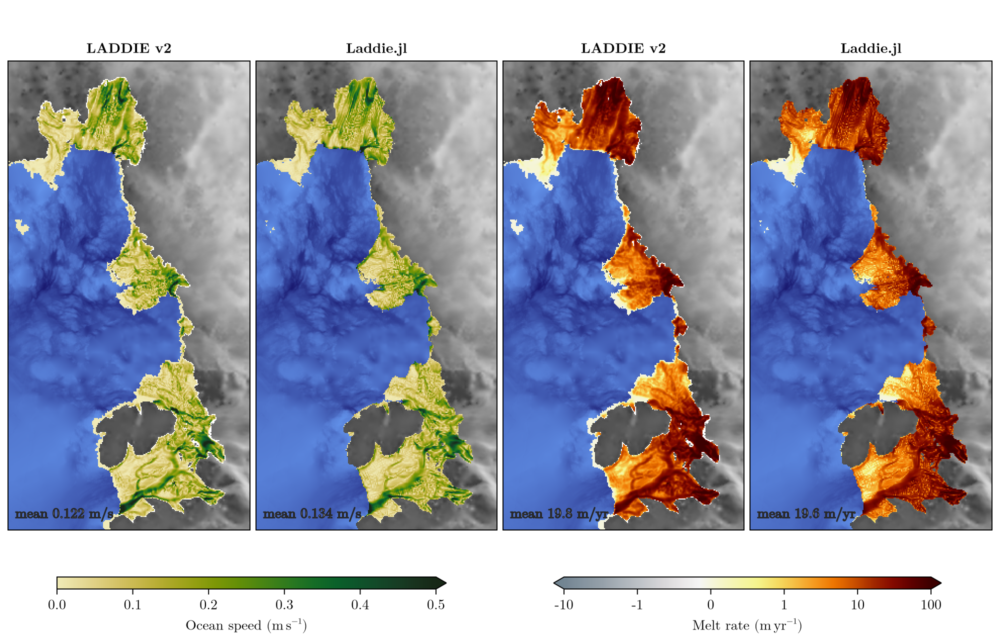
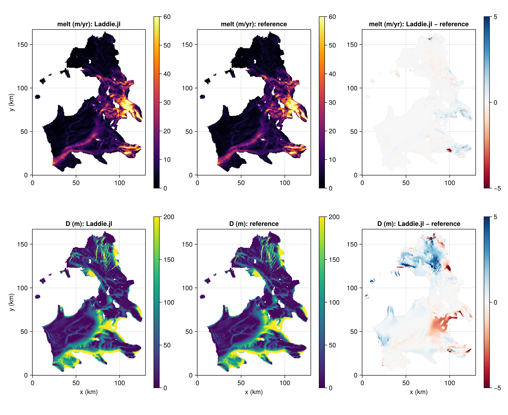
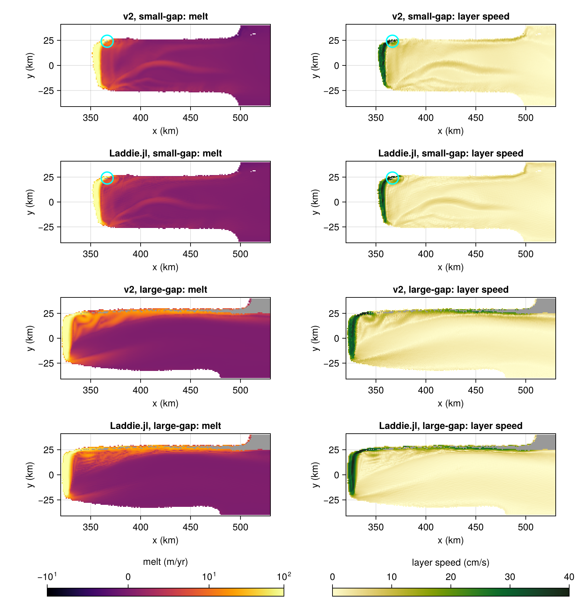
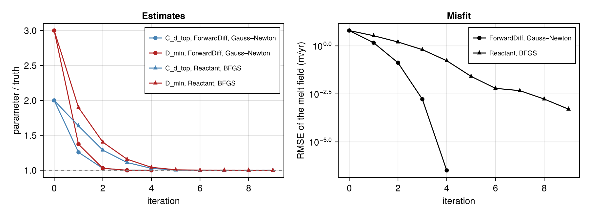

<h1 align="center">Laddie.jl</h1>

<p align="center">
  <b>Fast, differentiable basal melt beneath Antarctic ice shelves, on CPUs and GPUs.</b>
</p>

<p align="center">
  <a href="https://fesmc.github.io/Laddie.jl/dev/"></a>
  <a href="https://github.com/fesmc/Laddie.jl/actions/workflows/CI.yml?query=branch%3Amain"></a>
  <a href="https://codecov.io/gh/fesmc/Laddie.jl"></a>
</p>

<p align="center">
  
  <br>
  <sub>Amundsen Sea Embayment at 1 km: LADDIE v2 next to Laddie.jl.</sub>
</p>

Laddie.jl is a Julia implementation of **LADDIE**, the one-**L**ayer **A**ntarctic model for
**D**ynamical **D**ownscaling of **I**ce-ocean **E**xchanges
([Lambert et al., 2023](https://doi.org/10.5194/tc-17-3203-2023);
[Lambert et al., 2026](https://egusphere.copernicus.org/preprints/2026/egusphere-2026-930/)).
It treats the buoyant meltwater layer under an ice shelf as a depth-averaged circulation and returns
high-resolution basal melt-rate fields from the cavity geometry and an ambient temperature and
salinity profile.

## Highlights

- **CPU and GPU** from the same code, through
  [KernelAbstractions.jl](https://github.com/JuliaGPU/KernelAbstractions.jl) (CUDA, ROCm, Metal),
  in `Float64` or `Float32`.
- **Reactant.jl** compiles the whole time loop with XLA to accelerate GPU runs.
- **Differentiable**: ForwardDiff.jl on CPU and CUDA, and Enzyme through Reactant for gradients at a
  cost that does not grow with the number of parameters.
- **v2 physics on the v1 grid**: the physical choices of LADDIE v2 on the structured C-grid of v1,
  every difference an option.
- **Validated**: end-state agreement with LADDIE v1, and reproductions of the published Crosson–Dotson
  and Amundsen Sea runs.
- **Ice-shelf gaps**: sink and connected treatments, to quantify what happens where shelves thin
  through.
- NetCDF output, JLD2 restarts and a TOML provenance record for every run.

## Gallery

<table>
  <tr>
    <td width="50%" align="center">
      
      <br><sub><b>Reproducing a published run.</b> Crosson–Dotson Ice Shelf: Laddie.jl, the reference, and their difference.</sub>
    </td>
    <td width="50%" align="center">
      
      <br><sub><b>Ice-shelf gaps.</b> Melt and layer speed on the geometries of
      <a href="https://doi.org/10.5194/egusphere-2026-4237">Jesse et al. (2026)</a>.</sub>
    </td>
  </tr>
  <tr>
    <td colspan="2" align="center">
      
      <br><sub><b>Inverse problems.</b> Recovering model parameters from a melt field with gradients from
      ForwardDiff.jl and Reactant.jl.</sub>
    </td>
  </tr>
</table>

## Documentation

The [documentation](https://fesmc.github.io/Laddie.jl/dev/) has the full story: how to run a model,
the physics and numerics one page per choice, worked examples with data, and the API.

| | |
|---|---|
| [**LADDIE versions**](https://fesmc.github.io/Laddie.jl/dev/versions/) | v1, v2 and Laddie.jl side by side |
| [**Physics**](https://fesmc.github.io/Laddie.jl/dev/physics/) | the governing equations and every parameterisation |
| [**Numerics**](https://fesmc.github.io/Laddie.jl/dev/numerics/) | grid, time stepping, boundaries and stability |
| [**Examples**](https://fesmc.github.io/Laddie.jl/dev/generated/isomip/) | ISOMIP+, Crosson–Dotson, Amundsen Sea, gaps and inverse problems |
| [**Reactant backend**](https://fesmc.github.io/Laddie.jl/dev/reactant/) | compiled GPU runs and automatic differentiation |

## Installation

The package is not registered yet:

```julia
using Pkg
Pkg.add(url = "https://github.com/fesmc/Laddie.jl")
```

## Acknowledgements

Laddie.jl would not have been possible without the excellent model description papers and the clear,
open-source LADDIE codes: [v1](https://github.com/erwinlambert/laddie) and
[v2](https://github.com/UPSY-group/UPSY-models). Their authors are not involved in this port. Laddie.jl
does not aim to port v2's unstructured meshes; it focuses on other capabilities, such as GPU execution,
automatic differentiation and connected ice-shelf gaps.

## Citing

If you use Laddie.jl, please cite the model description paper:

> Lambert, E., Jüling, A., van de Wal, R. S. W., and Holland, P. R. (2023):
> Modelling Antarctic ice shelf basal melt patterns using the one-layer
> ocean model LADDIE, *The Cryosphere*, 17, 3203–3228,
> [doi:10.5194/tc-17-3203-2023](https://doi.org/10.5194/tc-17-3203-2023).

and the software itself via [CITATION.bib](CITATION.bib).

## License

GPL-3.0, see [LICENSE](LICENSE).
